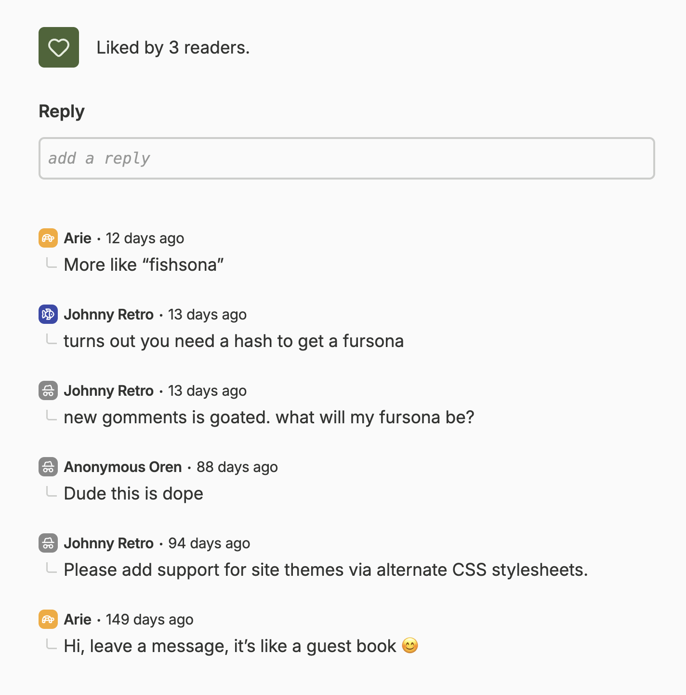
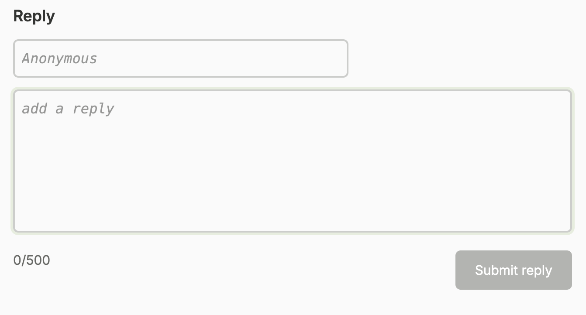

# Gomments

A commenting system for my personal website less.coffee.

It's dead simple and doesn't require registration, or even email. Commenters can identify themselves with a signature.

## Features

- Submit replies to articles
- List replies to articles
- React to articles (e.g. "Like")
- List stats for articles (reply count, reaction count)

## Architecture

- Single binary
- SQLite-backed
- REST-ish API :shrug:
- Dockerfile included
- Configure base path e.g environment can have `BASE_URL=/gomments` so that all routes are prefixed with `/gomments`

## Screenshots

This repo contains just the backend code for Gomments. The frontend code is stored in the `etch-less-coffee` repo. Here's an example of what that looks like:

